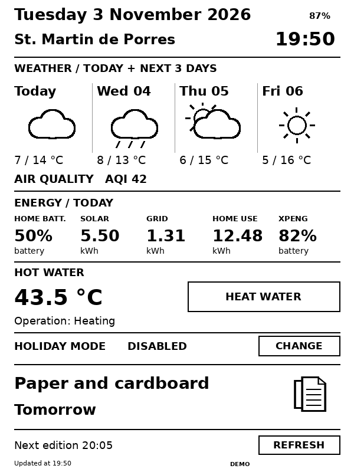

# Nook Casa

**Turn a Nook Simple Touch into an e-ink home newspaper powered by Home Assistant.**

Weather, energy, hot water, EV battery and upcoming waste collection on a 6-inch e-ink display. Two buttons control hot water and Holiday Mode; a third refreshes the page immediately. The Nook can sleep between updates while keeping the page visible.

<p align="center"></p>

*Generated by the actual renderer using sample data. [View the mockup](docs/MOCKUP.md).*

## Features

- Nook battery percentage in the top-right corner, updated at each device contact.
- A bold date, local time and saint header, without a separate newspaper title.
- Today's weather and a three-day forecast with monochrome icons, minimum/maximum temperatures and numeric AQI.
- Home battery charge, today's solar generation, grid import and total home consumption; XPENG battery charge.
- Current domestic hot water temperature and heat pump operating state; **HEAT WATER** button with confirmation.
- Holiday Mode status and a **CHANGE** button with explicit Enable/Disable options.
- Next waste collection with a material icon and relative day label (Today, Tomorrow, Day after tomorrow), or weekday and date without a year.
- Last update time, next edition time and a **REFRESH** button.

Automatic refresh in the `Europe/Rome` time zone: **every 15 minutes from 07:00 to 20:30**, and **every 2 hours from 20:30 to 07:00**. The interval shortens near either boundary to reach it. While forced hot water heating is active, the server requests updates every 60 seconds to follow the switch state; the same short polling applies for five minutes after a hot water request while the integration settles. This is not a real-time display: the printed clock also changes only when the image refreshes.

## How it works

A Python server running as a Home Assistant app/add-on reads entity states, forecasts and calendar events, then renders a 600 × 800 PNG. The Android client downloads it over HTTP on the local network, displays it, saves it as the screensaver and schedules the next wake-up.

Buttons are native touch regions over the image, not HTML controls. Tapping elsewhere opens the menu. **Wake the Nook with a physical button before using touch controls in standby.** The original TRMNL client opens its menu when tapped: install the Nook Casa APK for interactive controls.

## Hardware and compatibility

| Component | Requirement / verified setup |
| --- | --- |
| E-reader | Barnes & Noble **Nook Simple Touch BNRV300**, without built-in light |
| Firmware verified on the device | **1.2.1** |
| Operating system | Android **2.1**, API **7** |
| Display | 6-inch E Ink, **600 × 800**, portrait |
| Connectivity | Wi-Fi with network access to Home Assistant |
| Preparation | Rooted Nook; ADB used to install the client |
| Server | Home Assistant OS/Supervised with Supervisor and app/add-on support |
| Declared server architectures | `amd64`, `aarch64` |
| Original verified server setup | HAOS on Proxmox, `amd64` |

The BNRV300 is the Simple Touch, not the original 2009 Nook with a second LCD screen. Other models and firmware versions have not been verified by this project. The local Nook Casa workflow requires neither TRMNL cloud nor a TRMNL subscription. Your HA weather, AQI and vehicle integrations may have their own external dependencies.

## Quick installation

Full instructions: **[INSTALLATION.md](docs/INSTALLATION.md)**.

1. Back up the Nook before rooting or changing its system. This project does not automate rooting.
2. Add `https://github.com/samumar82/nook-casa` to the Home Assistant app/add-on store repositories and install **Nook Casa**. Alternatively, follow the local installation instructions.
3. Generate a local API key and configure `public_url`, `device_id` and your entity IDs. Start the app and check `/health`.
4. Download [nook-casa-0.4.0.apk](downloads/nook-casa-0.4.0.apk) and install it with ADB. Exit the original TRMNL app before launching Nook Casa.
5. In the client, enter API Base URL `http://HOME_ASSISTANT_IP:8099/api`, the server's Device ID and the same local API key.
6. Enable **Sleep between updates** and select the **TRMNL** screensaver in the original Nook settings. Verify a full sleep/wake cycle on the device.

The public server **0.4.0** and client **0.4.0** use English interface text. Server 0.3.0 introduced configurable entities compared with the personal 0.2.2 server. Server and client version numbers are independent. [Configuration and entity mapping](docs/CONFIGURATION.md).

## Security and command behavior

Port 8099 is intended for a trusted LAN. The verified legacy workflow uses HTTP: anyone able to inspect that traffic can read the local key. Do not expose this port to the Internet or use a personal Home Assistant token as the Nook API key. The server obtains `SUPERVISOR_TOKEN` internally.

`/api/display` and `/api/command` require the device ID and local key. Image URLs are signed and expire. Commands are restricted to `refresh`, `force_dhw`, `holiday_on` and `holiday_off`. Requests cannot supply arbitrary entities or service names. Only the two switches configured by the administrator can be controlled.

Buttons turn black on touch and while waiting for the refreshed image. HEAT WATER stays black while the configured force-heating switch is on, and returns to white at the next state refresh after it turns off. The separate override label is removed.

**Heat Water** only sends `switch.turn_on`: it is not a toggle and does not stop an active cycle. Holiday Mode uses explicit ON/OFF commands. Request IDs prevent duplicate execution within the deduplication window; uncertain outcomes are not retried automatically. No HA automations are modified. **Refresh** reads the latest states available in HA without forcing integrations to poll their upstream sources.

## Source code and development

- [`nook_casa/`](nook_casa/): Python server, Dockerfile and Home Assistant app configuration.
- [`android/`](android/): modified client based on TRMNL Nook Simple Touch v0.16.0.
- [`downloads/`](downloads/): installable APK and checksum.
- [`tests/`](tests/): mock-HA checks and refresh schedule tests.
- [`docs/BUILD.md`](docs/BUILD.md): legacy Android build and signing instructions.

Run the server checks with Python 3.12, Pillow and tzdata:

```bash
python3 -m pip install -r requirements-dev.txt
python3 tests/test_server.py
python3 tests/test_controls.py
python3 tests/test_schedule.py
python3 tests/test_layout.py
```

Tests cover rendering, authentication, signed image URLs, allowed commands, deduplication, calendar parsing and scheduling. The renderer test regenerates the sample image. DEX compilation and APK signing have been verified. The earlier local server and client were tested on a BNRV300; the English build and long-running wake/touch behavior still need physical-device verification. Battery life is not specified in days: it depends on battery condition, Wi-Fi signal and wake-up frequency.

## License and acknowledgments

**MIT**, retaining the original **BPMCT** copyright notice. The client derives from [`usetrmnl/trmnl-nook-simple-touch`](https://github.com/usetrmnl/trmnl-nook-simple-touch), tag `v0.16.0`. This standalone repository combines the modified client and HA server; it is not a GitHub-network fork of the original repository. [Provenance and third-party licenses](THIRD_PARTY_NOTICES.md).

This independent project is not affiliated with Barnes & Noble, TRMNL, Home Assistant, Mitsubishi Electric or XPENG. Product names and trademarks belong to their respective owners.
