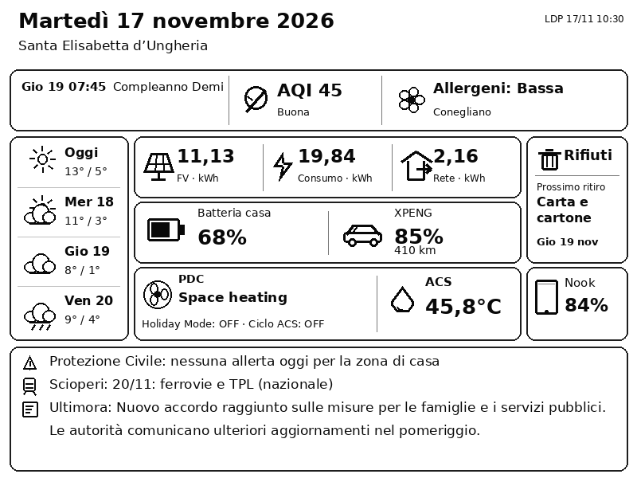

# Nook Casa · Home Assistant e-ink dashboard

**Versione 0.10.1 · Interfaccia orizzontale, sola visualizzazione.**

Nook Casa trasforma un Barnes & Noble Nook Simple Touch BNRV300 (Wi-Fi, Android 2.1, 600 × 800) in un pannello informativo collegato a Home Assistant. La versione 0.10.0 utilizza una **dashboard orizzontale 800 × 600** con sole informazioni: il touch non è necessario.



*L'immagine PNG illustra il layout di base 0.10.0; le rifiniture 0.10.1 (agenda, allergeni, XPENG, batteria domestica e rifiuti) sono documentate in [MOCKUP.md](docs/MOCKUP.md). Non è una cattura di sensori reali.*

## Cosa mostra

- Data con iniziale maiuscola, santo del giorno e `LDP gg/mm hh:mm` nell'angolo superiore destro.
- Due prossimi appuntamenti del calendario personale, con riquadro ampliato e AQI della stessa larghezza.
- Previsioni meteo di oggi e dei tre giorni successivi, AQI e livello allergeni su due righe (senza località).
- Produzione fotovoltaica, consumo di casa e prelievo dalla rete (kWh di oggi).
- Batteria casa con percentuale SOC e **kWh caricati/scaricati oggi**; percentuale XPENG e autonomia residua in km affiancate, se il sensore è valido.
- Stato operativo PDC, temperatura ACS, Holiday Mode e ciclo forzato ACS, tutti **senza pulsanti**.
- Rifiuti: materiale e data con font più grandi, senza la scritta «Prossimo ritiro».
- Percentuale della batteria Nook.
- Una sezione notizie senza intestazione, con priorità alle allerte locali di Protezione Civile e agli scioperi pertinenti, poi Ultimora. L'allerta verde non viene rappresentata come emergenza.

Il pannello è ottimizzato per e-ink in scala di grigi; le icone sono disegnate con Pillow e non dipendono da font speciali o servizi di immagini.

## Compatibilità

| Voce | Specifica |
| --- | --- |
| Hardware verificato | Nook Simple Touch **BNRV300**, firmware 1.2.1 |
| Sistema | Android 2.1 / API 7, dispositivo rootato |
| Immagine fornita all'APK | **600 × 800 PNG**, con contenuto orizzontale ruotato |
| Contenuto leggibile sul Nook ruotato fisicamente | **800 × 600** |
| Client | APK Nook Casa 0.4.1 già in uso; non occorre ricompilarlo per il layout |
| Server | Add-on Home Assistant, Python 3.12 + Pillow |
| Periodicità | Ogni 15 min tra 07:00–20:30, ogni 2 ore durante la notte |

L'APK precedente può ancora contenere funzioni touch legacy, ma nella dashboard 0.10.0 non compaiono più pulsanti o regioni cliccabili necessarie.

## Installazione

Per **nuove installazioni**, aggiungere il repository `https://github.com/samumar82/nook-casa` nello store Home Assistant, installare Nook Casa e configurare i propri entity ID, il calendario e l'API key. I nomi di sensori in `config.yaml` sono esempi: **non** sono dati reali garantiti. Vedi [guida](docs/INSTALLATION.md) e [configurazione](docs/CONFIGURATION.md).

Per l'impianto personale che era sulla 0.6.0, la 0.10.0 è stata verificata con un **aggiornamento locale protetto e backup preventivo**, non con una reinstallazione dell'APK. Non usare indiscriminatamente l'updater su server diversi dalla 0.6.0 verificata: controlla lo SHA-256 e leggi la guida aggiornamenti.

## Codice e verifiche

- `nook_casa/server.py`: server integrato 0.10.0, con renderer e raccolta dati.
- `nook_casa/collector_v010.py`: modulo sorgente della raccolta informazioni aggiuntive.
- `nook_casa/renderer_v010.py`: modulo sorgente del rendering 800 × 600.
- `docs/images/mockup-landscape-v010.png`: mockup finale, generato realmente dal renderer.
- `android/`: client Nook Simple Touch basato sul progetto TRMNL.
- `tests/`: controlli rendering, API, calendario e periodicità.

```bash
python3 -m pip install -r requirements-dev.txt
python3 tests/test_v010.py
```

## Sicurezza

La porta 8099 è pensata per una rete locale attendibile. HTTP non cifra la chiave del client: non pubblicare il servizio su Internet e non usare un token personale Home Assistant come API key del Nook. Le immagini sono accessibili tramite URL firmati con scadenza; i comandi HTTP legacy restano nella codebase per compatibilità, ma **non** sono esposti da elementi interattivi nella nuova schermata.

## Licenza

MIT; attribuzioni, provenienza del client e avvisi di terze parti in [THIRD_PARTY_NOTICES.md](THIRD_PARTY_NOTICES.md). Progetto indipendente da Barnes & Noble, TRMNL, Home Assistant, Mitsubishi Electric e XPENG.

> **Installazione esistente:** la 0.10.0 locale già funzionante non viene modificata da questa pubblicazione GitHub. La 0.10.1 è un aggiornamento pubblico distinto; prima di installarla in Home Assistant, conservare un backup della versione personalizzata.
