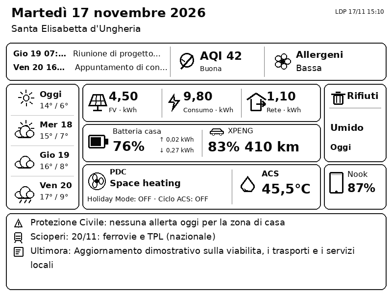

# Mockup e geometria: Nook Casa 0.10.1 orizzontale

Questa immagine è generata automaticamente dal renderer **0.10.1** con valori fittizi. Include agenda allargata, AQI invariato, allergeni su due righe, percentuale XPENG e km affiancati, kWh di carica/scarica della batteria casa e rifiuti più leggibili. La pagina logica misura 800 × 600 pixel; il server ruota il PNG a 600 × 800 prima di inviarlo al client Android esistente.

## Disposizione della pagina

- **Testata:** data, santo del giorno e `LDP` in alto a destra.
- **Fascia alta:** agenda ampliata da 275 a 335 px, AQI invariato (192 px), allergeni ridotti a 249 px, con rischio sotto il titolo e senza città.
- **Corpo:** quattro giorni meteo; FV, consumi e rete; batteria casa con SOC e due energie giornaliere (↑ caricata / ↓ scaricata, kWh); XPENG con percentuale e km affiancati in ugual font e icona compatta; PDC, ACS, Holiday Mode, ciclo ACS; rifiuti con testo leggermente ingrandito e senza sottotitolo; batteria Nook.
- **Fascia inferiore:** cinque righe di notizie e allerte, **senza titolo né icona d'intestazione**, senza separatore e senza footer. Le icone degli avvisi hanno ciascuna uno spazio dedicato e non si sovrappongono ai testi.

La sezione Protezione Civile usa le allerte delle entità Home Assistant riferite alla zona di casa; lo sciopero prossimo compare solo se attinente e imminente (entro cinque giorni). Informazioni sconosciute mostrano un trattino, mai dati inventati. Le informazioni di Ultimora vengono trattate come notizie, non come allerta ufficiale.

## Posizione fisica e client

Il Nook BNRV300 dispone di uno schermo fisico 600 × 800. Si posiziona **orizzontalmente**, senza necessità di touch; la bitmap fornita all'APK rimane 600 × 800 per compatibilità con il client esistente.

## Versioni precedenti

I mockup `mockup.png` e `mockup-it.png` illustrano l'interfaccia legacy verticale con pulsanti e sono conservati soltanto per riferimento storico. Il file **mockup-landscape-v010.png** documenta la schermata originale 0.10.0; **mockup-landscape-v0101.png** è l'immagine aggiornata. Per rigenerarla eseguire `python tests/generate_mockup_v0101.py` dalla radice del repository.
