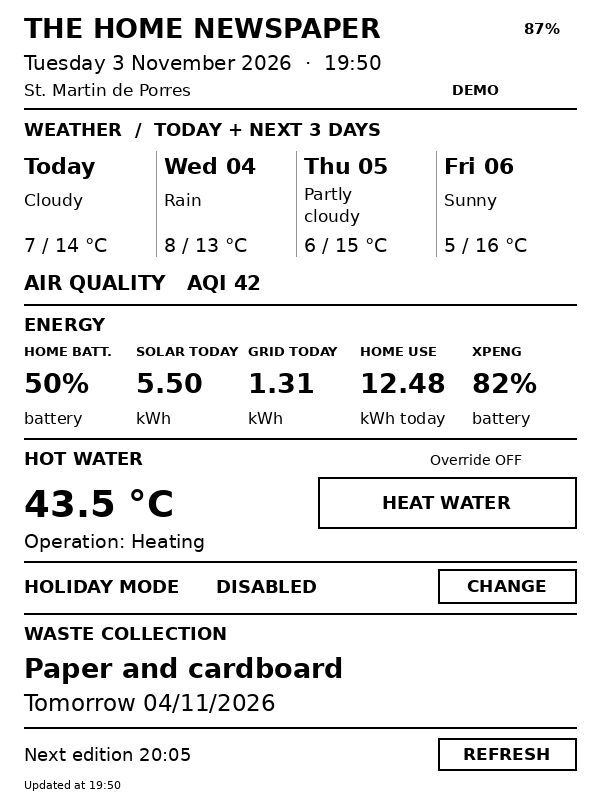

# Home newspaper mockup



The image is generated by the same Pillow renderer used by the server. It contains sample data, not readings from a real home.

The small percentage on the first line is the Nook battery (87% in this demo).

The Energy section has five columns: home battery, solar today, grid import today, home consumption today and XPENG. HEAT WATER, CHANGE and REFRESH are framed and centered within their rows.

## Client touch regions

Coordinates in the reference 600 × 800 PNG, scaled by the client to the displayed image:

| Button | X | Y | Action |
| --- | --- | --- | --- |
| HEAT WATER | 318–576 | 477–528 | Confirm domestic hot water heating |
| CHANGE | 438–576 | 569–603 | Enable or disable Holiday Mode |
| REFRESH | 438–576 | 738–770 | Read current HA data and generate a new PNG |

These coordinates are part of the server/client interface. Moving the image buttons requires updating the client too. Other taps open the menu; touch is unavailable while the device is in standby.

Regenerate the mockup from the repository root:

```bash
python3 tests/test_server.py
```
